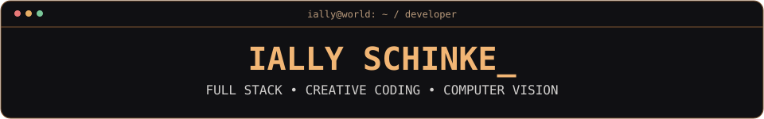
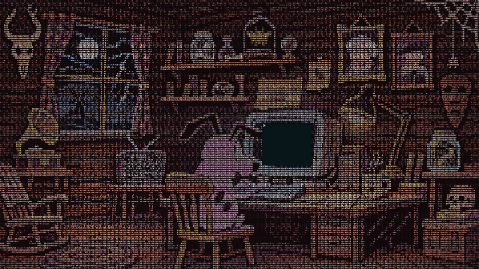
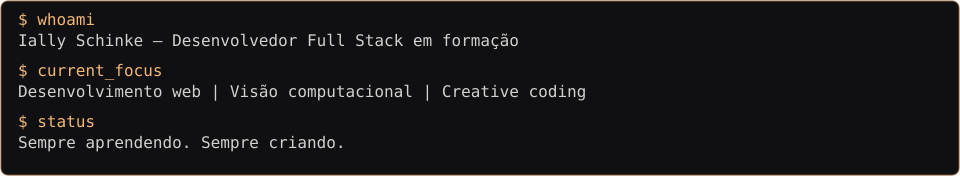

  

  

<i>Sejam bem-vindos ao meu mundo.</i>

  <a href="https://iallyschinke.github.io/Ially-Portfolio/">Portfólio</a> ·
  <a href="mailto:iallyschinke@gmail.com">E-mail</a> ·
  <a href="https://github.com/iallyschinke?tab=repositories">Repositórios</a>

---

## 01 / Sobre mim

Estudante do SENAC, desenvolvo aplicações web, exploro automação, acessibilidade e experiências digitais interativas. Gosto de combinar programação, arte e tecnologia para transformar ideias em projetos.

## 02 / Tech stack

### Frontend

  
  
  
  
  
  
  
  

HTML5 · CSS3 · JavaScript · TypeScript · React · Vite · Next.js · Tailwind CSS

### Backend

### Backend

  
  
  

Node.js · Express · Fastify

### Banco de dados

### Banco de dados

  
  
  
  

MySQL · MariaDB · SQLite · MongoDB

### Integrações e estudos

### Integrações e estudos

  
  
  

RabbitMQ · Apache Kafka · Swagger

### Ferramentas

### Ferramentas

  
  
  
  

Git · GitHub · Bash · VS Code

**Creative coding:** MediaPipe · GSAP · Canvas API · ASCII Art

---

## 03 / Projetos em destaque

| Projeto | Descrição |
| --- | --- |
| [Ially Portfolio](https://github.com/iallyschinke/Ially-Portfolio) | Portfólio pessoal interativo, com identidade visual e experiências digitais. |
| [Gestão SENAC AL](https://github.com/iallyschinke/gestao-senac-al) | Aplicação web voltada à gestão educacional. |
| [Projeto Integrador](https://github.com/iallyschinke/projeto-integrador) | Projeto colaborativo; contribuição nas áreas de tecnologias e integrantes. |
| [Web Services](https://github.com/iallyschinke/web-services-apresentacao) | Apresentação interativa sobre serviços web. |
| [Projeto Filmes](https://github.com/iallyschinke/projeto-filmes) | Projeto de estudo com estrutura de backend. |

## 04 / Laboratório experimental

Projetos pessoais e protótipos em desenvolvimento.

| Projeto | Área de exploração |
| --- | --- |
| **Libras Vision** | Reconhecimento de sinais e acessibilidade por webcam. |
| **Persona Gesture Lab** | Controle de experiências interativas por gestos. |
| **Typoverse Lab** | Tipografia dinâmica e animações digitais. |
| **AffiliateBot AI** | Automação e gerenciamento de produtos afiliados. |
| **The Scream Gesture Art** | Experimento de arte e visão computacional. |
| **ASCII Art Lab** | Animações ASCII, incluindo CORAGEM.EXE. |

---

## 05 / Formação e certificados

| Formação / curso | Certificado |
| --- | --- |
| Visão Computacional | [Ver certificado](https://hermes.dio.me/certificates/TJJJFAPQ.pdf) |

## 06 / Atividade no GitHub

  
  

---

<code>system.status: ONLINE_</code>

<i>Code. Create. Repeat.</i>

